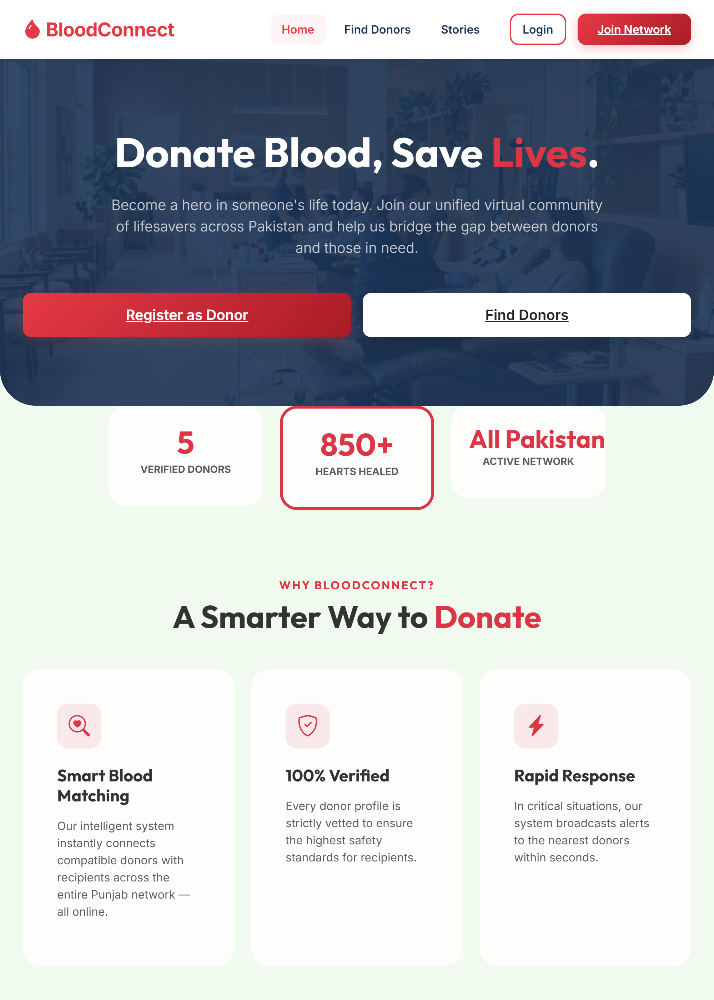
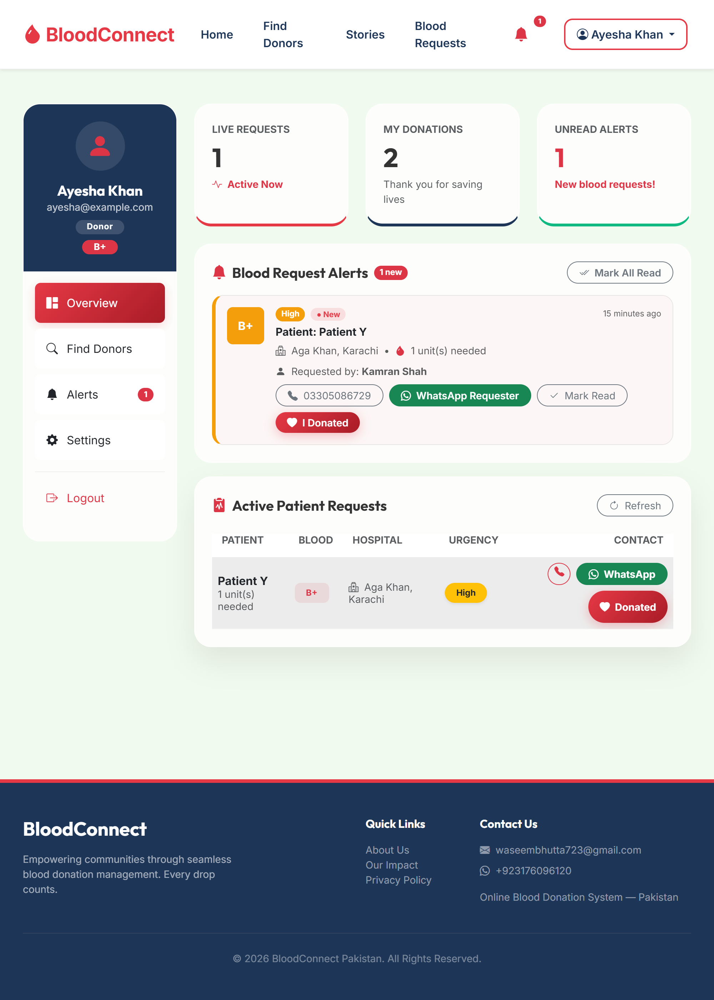
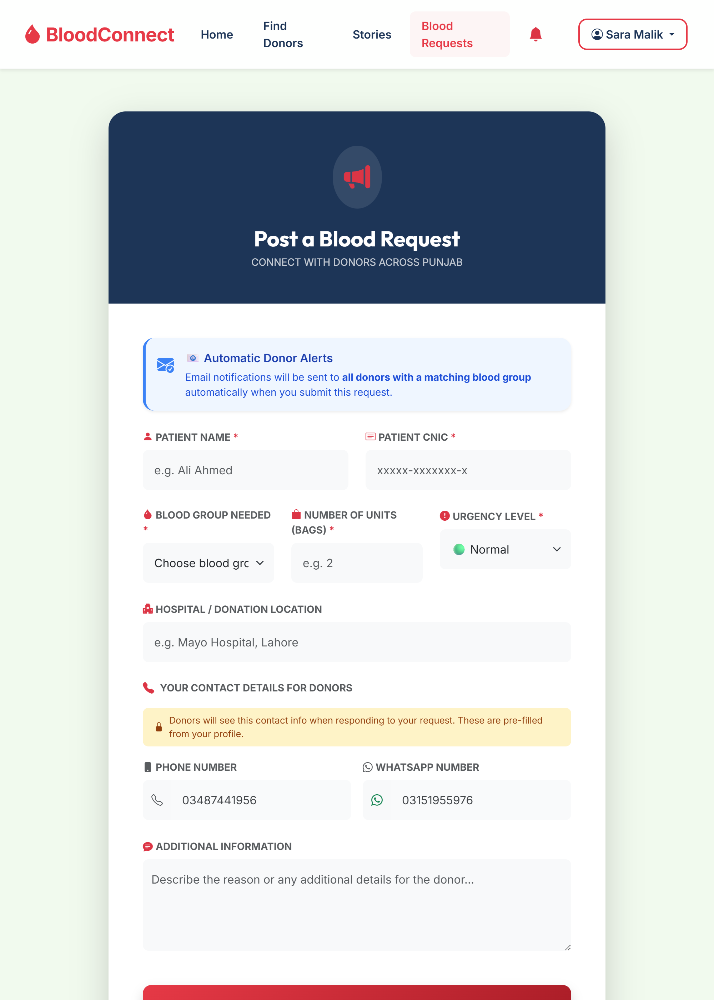
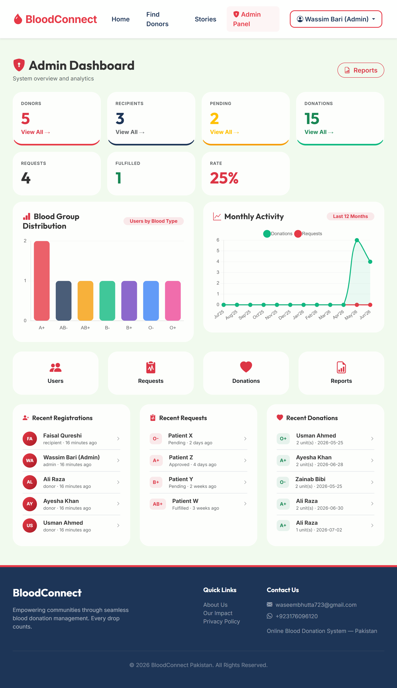
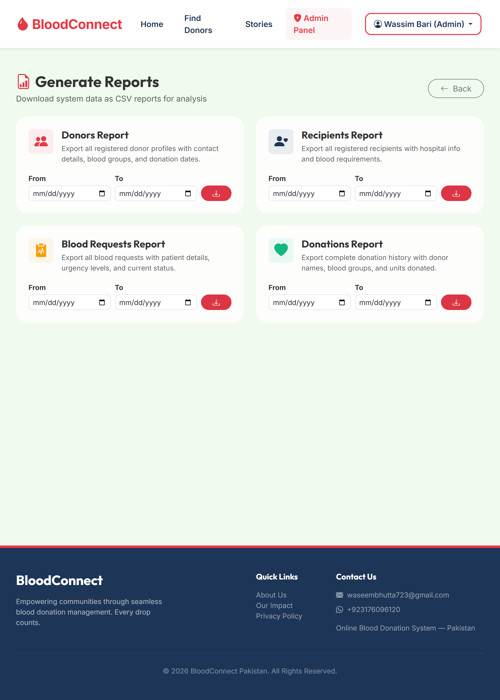
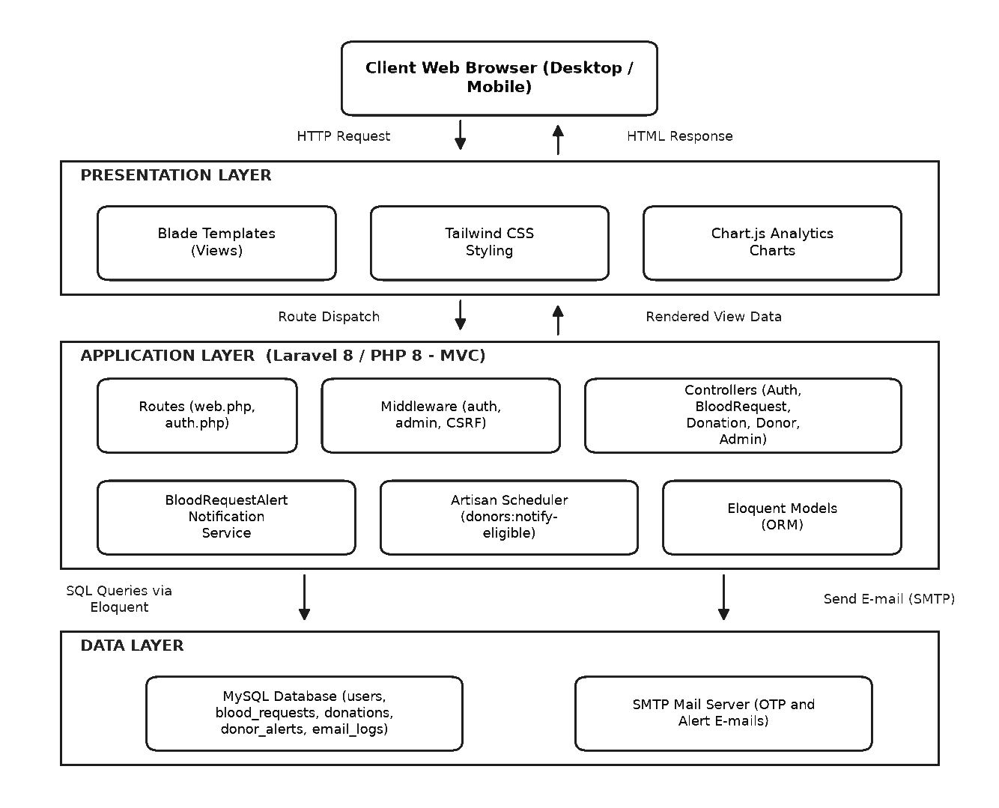
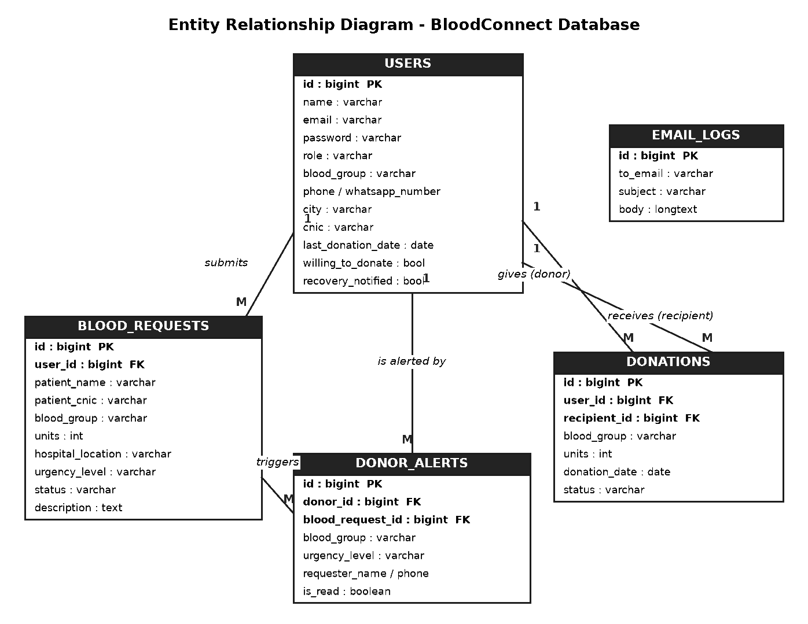

# 🩸 BloodConnect — Blood Donation & Emergency Request Management System


**BloodConnect** is a full-stack web platform that bridges the gap between blood donors, patients/recipients, and hospitals during medical emergencies. Built with **Laravel**, **Tailwind CSS**, and **MySQL**, it automates donor matching, enforces medical safety intervals (90-day recovery tracking), prevents duplicate/spam emergency requests via CNIC validation, and provides a comprehensive analytics & reporting suite for administrators.

---

## ✨ Key Features

### 🔐 Multi-Role Authentication & OTP Verification
- Dedicated workflows for **Donors**, **Recipients**, and **Administrators**.
- Email **OTP verification** during user registration to ensure authentic donor and recipient profiles.

### 🚨 Smart Emergency Blood Requests & Anti-Spam Validation
- **CNIC Identity Validation:** Enforces Pakistani CNIC format (`XXXXX-XXXXXXX-X`) and ensures a 1-to-1 mapping between a patient CNIC and patient name.
- **Duplicate Request Prevention:** Blocks accidental same-day duplicate submissions and restricts each patient to one active pending emergency request at a time.
- **Urgency Prioritization:** Categorizes requests by `Normal`, `High`, or `Critical` urgency.

### 🔔 Automated Donor Matching & Instant Alerts
- Automatically matches newly created blood requests with eligible donors of the required blood group.
- Dispatches **in-app notifications** and **email alerts** with hospital location and urgency details.
- Includes a built-in local **Mail Viewer (`/inbox`)** for testing and inspecting dispatched emails locally.

### 🗓️ 90-Day Medical Recovery Tracking & Automated Reminders
- Enforces a **90-day cooldown period** after each confirmed donation (`User::isEligibleToDonate()`).
- Includes a custom Artisan scheduled command (`php artisan donors:notify-eligible`) that automatically emails donors once their 90-day recovery period is complete.

### 📊 Admin Dashboard, Analytics & CSV Exports
- Real-time statistics on total donors, recipients, pending/fulfilled requests, and completed donations.
- Interactive charts for blood group distribution and 12-month donation/request trends.
- Full user, request, and donation management with **CSV report generation** filtered by date range and category.

---

## 📸 Screenshots

### Home & Public Donor Search
| Landing Page | Donor Directory & Search |
| :---: | :---: |
|  |  |

### Donor & Recipient Workflows
| Donor Dashboard | Create Emergency Blood Request |
| :---: | :---: |
|  |  |

### Administrator Portal & Analytics
| Admin Analytics Dashboard | Reports & CSV Export |
| :---: | :---: |
|  |  |

---

## 🏗️ System Architecture & Design

| System Architecture | Entity Relationship Diagram (ERD) |
| :---: | :---: |
|  |  |

---

## 🛠️ Tech Stack

- **Backend:** PHP 8.0+, Laravel 8, Laravel Breeze, Laravel Sanctum
- **Frontend:** Blade Templates, Tailwind CSS 3, Alpine.js, Chart.js
- **Database:** MySQL / SQLite (for automated testing)
- **Testing:** PHPUnit (Unit & Feature test suites)

---

## 🚀 Getting Started (Local Setup)

### Prerequisites
- PHP >= 8.0 & Composer
- MySQL (e.g., via XAMPP, Laragon, or WAMP)
- Node.js & NPM

### Installation Steps

1. **Clone the repository**
   ```bash
   git clone https://github.com/waseemfullstack88-prog/BloodConnect.git
   cd BloodConnect
   ```

2. **Install PHP & Frontend dependencies**
   ```bash
   composer install
   npm install && npm run dev
   ```

3. **Configure environment variables**
   ```bash
   cp .env.example .env
   php artisan key:generate
   ```
   *Update `DB_DATABASE`, `DB_USERNAME`, and `DB_PASSWORD` in `.env` to match your local MySQL setup.*

4. **Run database migrations & seed demo data**
   ```bash
   php artisan migrate --seed
   ```

5. **Start the development server**
   ```bash
   php artisan serve
   ```
   Visit `http://127.0.0.1:8000` in your browser.

---

## 🔑 Demo Credentials (via Database Seeder)

After running `php artisan migrate --seed`, you can log in with the following accounts:

| Role | Email | Password |
| :--- | :--- | :--- |
| **Admin** | `admin@bloodconnect.pk` | `password` |
| **Donor** | `ali@example.com` | `password` |
| **Recipient** | `sara@example.com` | `password` |

---

## 🧪 Running Automated Tests

The project includes unit and feature tests covering donor 90-day eligibility, registration OTP verification, donation restrictions, and authentication flows:

```bash
php artisan test
```

---

## 📄 License

This project is open-source and available under the [MIT License](https://opensource.org/licenses/MIT).
